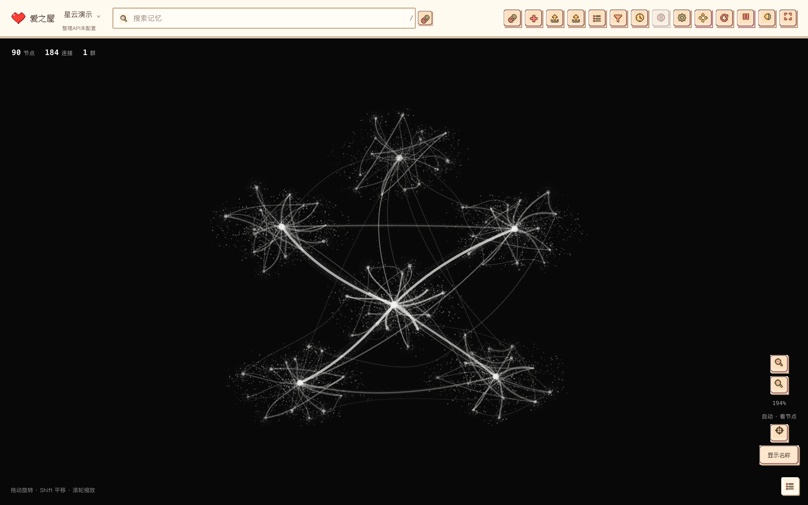
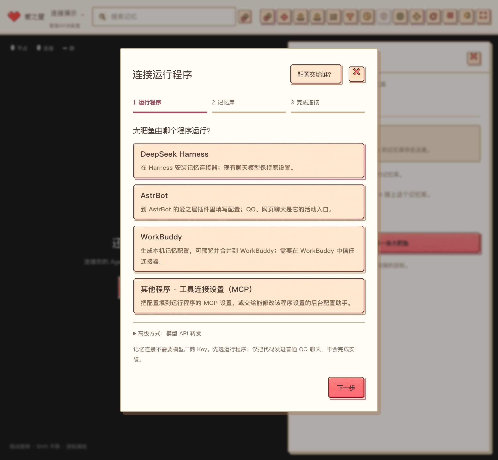
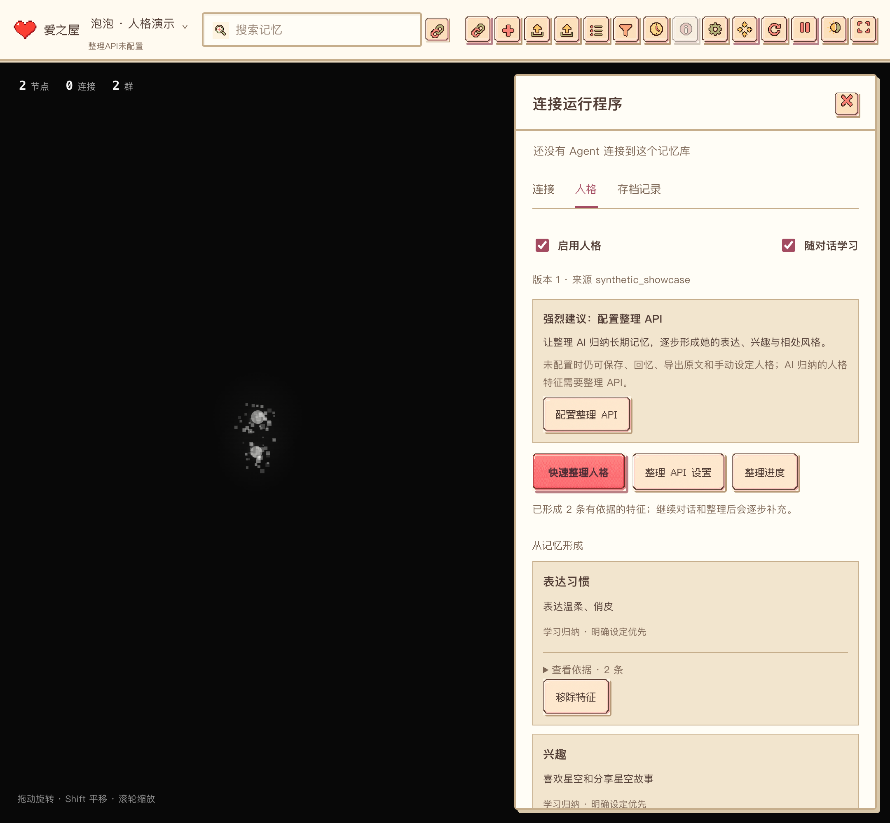

<div align="center">

[](assets/branding/project-banner-0102.svg)

**给个人 Agent 的长期记忆之家。**

你继续在熟悉的客户端与它相处，爱之屋负责保存、整理和找回记忆。  
记忆归属于这个 Agent；换窗口、换模型，也可以接着使用同一个存档。

[**下载安装**](#下载) · [**三步连接**](#三步连接) · [手机版安装](docs/手机版安装与使用.md) · [存档继承](#带着记忆去新窗口) · [许可与署名](#使用许可与署名)

公开下载 · 非商业使用 · 保留作者署名  
作者：[myflww](https://github.com/myflww) · [PolyForm Noncommercial 1.0.0](LICENSE)

</div>

[](assets/screenshots/love-house-overview-0102.png)

<sub>macOS 界面，使用独立合成演示数据。图片可以点击查看原图；不同平台以各自下载版本与验证记录为准。</sub>

## 爱之屋能帮你做什么

**原文先保存 → 按预算整理 → 需要时找回。** 聊天和操作仍由你自己的 Agent 宿主管理。

| 你想做的事 | 爱之屋怎样帮助你 |
|---|---|
| 留住一起经历的事 | 接收已接入宿主提交的真实对话与事件，保留时间、来源和原文，依据证据归纳发生了什么、原因和结果 |
| 为每个 Agent 分开记忆 | 每个存档拥有独立身份；连接固定到指定存档，浏览其他库不会改绑 |
| 把记录整理成记忆与人格 | 用你配置的模型归纳事实、偏好、经历与角色特征，结果有原话依据，固定设定优先 |
| 看见并管理记忆 | 在动态星云或平面图中查看节点；搜索、更正、停用、忘记和恢复都由你掌握 |
| 换一个窗口继续相处 | 新窗口接回原存档；也能导出完整分享包，导入为另一份独立副本 |

新建存档从空白开始，没有预设人格或虚构经历。框架示例单独存放，不进入个人记忆，也可以移入回收站。没有关联的记忆可以独立存在，仍能正常检索和回忆。

## 下载

**Windows 提供 0.10.2rc1 修复预览；macOS 为 0.10.2 稳定版，Android / iPhone 主屏幕版继续使用 0.8.0rc2。请按系统选择下载，并核对本轮 Windows 发布状态。**

| 你的系统 | 版本与下载 | 使用要求与验证状态 |
|---|---|---|
| Windows x64 · Intel / AMD 64 位 | [安装版 EXE](https://github.com/myflww/love-house/releases/download/v0.10.2rc1/LoveHouse-Setup-0.10.2rc1-Windows-x64.exe) · [便携版 ZIP](https://github.com/myflww/love-house/releases/download/v0.10.2rc1/LoveHouse-0.10.2rc1-Windows-x64.zip) | 0.10.2rc1 AstrBot 接入、整理 API 状态与星云自旋修复预览；技术最低 Win10 2004/19041 或 Win11。本轮 Windows 完成范围见发布状态与验证记录，Win10 待实机验收 |
| macOS · Apple Silicon（M 系列） | [0.10.2 稳定版 ZIP](https://github.com/myflww/love-house/releases/download/v0.10.2/LoveHouse-0.10.2-macOS-arm64.zip) | macOS 13.0+；解压后把“爱之屋.app”放入应用程序目录 |
| 主流 Android 手机 | [0.8.0rc2 APK](https://github.com/myflww/love-house/releases/download/v0.8.0rc2/LoveHouse-0.8.0rc2-Android.apk) · [发布与校验](https://github.com/myflww/love-house/releases/tag/v0.8.0rc2) | 技术最低 Android 8.0；保持系统 WebView 更新。通用已签名 APK，真实手机待验收 |
| iPhone | [打开主屏幕版](https://love-house-mobile-myflww.haixiac34.chatgpt.site) | Safari 打开 → 分享 → 添加到主屏幕；技术最低 iOS 15.4。PWA 网页应用，无 IPA；真机待验收 |
| macOS Intel / Windows ARM64 / Windows 32 位 | 暂无对应原生桌面包 | 当前不承诺这些架构的兼容性 |
| Linux / 源码开发 | [源码](https://github.com/myflww/love-house) | 暂无 Linux 桌面包；Python 3.11+ 可运行本地服务 |

<details>
<summary>安装要求、签名、校验与手机版说明</summary>

手机版支持手动记录、检索、多库、标签星图及桌面分享 JSON 导入导出，记忆保存在各自设备；也可打开个人 HTTPS 服务管理 Agent 连接；电脑宿主仍需自行配置。安装、离线使用与备份方法见 [手机版安装与使用](docs/手机版安装与使用.md)。

桌面包不需要自行安装 Python 或 Node。Windows 安装版按当前用户安装；便携版须完整解压后打开 `LoveHouse.exe`。新版携带经过微软签名与 SHA256 验证的离线 WebView2 修复组件，缺失时明确询问后安装。

Windows 使用 [Windows-SHA256SUMS.txt](https://github.com/myflww/love-house/releases/download/v0.10.2rc1/Windows-SHA256SUMS.txt)，macOS 使用 [SHA256SUMS.txt](https://github.com/myflww/love-house/releases/download/v0.10.2/SHA256SUMS.txt)。GitHub 的自动 Source code 文件不是桌面安装包；旧 Windows 0.5.0 存在启动兼容反馈，请改用上面的修复预览。

Windows 0.10.2rc1 延续人格、独立记忆与原版星图能力，新增 AstrBot 接入配置、整理 API 状态和星云自旋改进。下载前核对 [更新说明](docs/WINDOWS-0102-UPDATE.md)、[Windows 验证附件](https://github.com/myflww/love-house/releases/download/v0.10.2rc1/Windows-0102-verification.json) 与 [公开下载安装记录](https://github.com/myflww/love-house/actions/runs/41339499539)；固定发布记录见下方“版本进展”。

完整安装步骤、系统/芯片范围、验证结果和 Agent 接入差异见 [下载与系统支持](docs/下载与系统支持.md)。主程序签名状态：macOS 为本地签名、未公证，Windows 未附发行商代码签名；请核对来源与校验值，保留系统安全保护。

</details>

## 三步连接

### 1 · 选择它的记忆存档

打开爱之屋，选择已有存档继续使用，或为另一个 Agent 新建空白库。一个 Agent 可以接入多个明确登记的活动来源；不同 Agent 使用不同存档。

### 2 · 把配置交给运行 Agent 的程序

| 你在哪里运行它 | 配置应该交给谁 |
|---|---|
| DeepSeek Harness | Windows 与 macOS 可使用专用插件向导：检测版本、备份配置，再连接目标窗口。Windows 沿用已验证的 `0.2.1-rc.3`／`rc.5` 与实际 SDK 契约检查；macOS 的验证范围见对应发布说明 |
| 其他支持 MCP 的本机 Agent | 选择“复制记忆连接配置”，点击“复制给 Agent”，交给具备本机配置能力的 Agent 或宿主保存、加载；**这一步不需要模型厂商 API Key**。WorkBuddy 提供预览与确认合并入口 |
| AstrBot／QQ 等活动来源 | 在“同鱼活动来源”选择 AstrBot，按当前库生成固定来源标识；粘贴目标会话的完整 `/sid`、确认归属，再取得插件 JSON 与安装步骤。配置交给 **AstrBot 宿主的插件设置**，不是发到普通 QQ 聊天中 |

macOS 0.10.2 与 Windows 0.10.2rc1 的快速向导使用 **AstrBot 实验插件 0.3.0**。配置文件须由 AstrBot 能访问的同机文件系统生成；另一台服务器或隔离容器不能直接复用电脑绝对路径。已有绑定先备份、再合并，不能覆盖其他 Agent 的来源。见 [AstrBot 插件与快速配置](https://github.com/myflww/love-house/blob/v0.10.2/extensions/astrbot-love-house/README.md)、[同鱼多平台接入](https://github.com/myflww/love-house/blob/v0.10.2/docs/同鱼多平台接入.md) 与 [活动来源 SDK](https://github.com/myflww/love-house/blob/v0.10.2/docs/同鱼多平台接入.md#sdk-宿主实际要做什么)。

MCP 提供记忆工具；每轮自动保存还需要宿主提交真实的轮次结束回调。Harness 专用插件已处理相应回调，其他宿主以对应适配器的验证结果为准。爱之屋不会扫描任意聊天窗口，也不会因为配置一次就自动观察外部执行器里的所有活动。

### 3 · 聊一轮，核对它真的记下了

查看界面的“记忆工具已连接”和“自动存档已验证”。工具能用、配置已保存和实际收到回调，是不同的状态；收到真实记录后再确认接入成功。AstrBot 可先在已登记会话使用 `/lovehouse_status`，再核对完整对话是否增加；插件生成、安装或最终输出不代表 QQ 送达、收件人已读或完整平台覆盖。

配置保存一次后，再打开爱之屋和 Agent 宿主会寻找本机服务。已经提交且由本机队列持久接管的离线记录，恢复后继续补交；排队不等于远端已入库。协议见 [Agent 连接器](nkb/service/AGENT_CONNECTOR.md)。

**默认只记录目标窗口。** Harness 与新的通用 Agent 连接在目标窗口首轮后固定真实会话 ID；其他窗口在原文进入队列和存档前被排除，服务端再次核对。原窗口 ID 稳定时重启继续连接；新窗口通过“连接新窗口”选择原存档。高级“整个连接”范围可能包含多个窗口，需要明确允许。API 单窗口模式须发送真实 `X-NKB-Session`，缺少时拒绝接收，不能用占位 ID 混装多个窗口。AstrBot 则只接收管理员明确登记、归属于当前 Agent 的来源白名单。

## 让整理 AI 帮你归纳

**强烈建议为当前库配置整理 API，并按需要开启自动整理。** 可设置累计 N 条新记录后处理，或手动启动。调用受本库次数和字符预算控制，费用由你选择的服务计收。

库名下会显示 **当前库整理 API 状态**；打开整理面板，可核对服务、模型、密钥保存范围和最近失败。查看或保存设置本身不会发起付费请求。**“已配置”只代表本机配置，不代表联网已验证。** 若密钥仅本次会话有效，重启后需重新填写；换库时重新读取该库状态，不沿用另一库的配置。

不配置整理 Key，仍能保存原文、检索、完整导出和手动设定人格。Agent 的记忆连接本身不需要模型厂商 Key。高级“模型 API 转发”是另一条可选路径，只有选择转发模型请求时才需要相应凭据。

macOS 0.10.2 与 Windows 0.10.2rc1 默认启用人格和学习，具体内容保持空白起步；你手动关闭的选择会保留。导入标有 AI 角色的历史聊天后，可先预览范围，再“快速整理人格”；平时整理记忆也会逐步补充有原话依据的特征。固定设定优先，自动特征可查看依据、移除或关闭。手机 0.8.0rc2 尚未移植这些桌面人格整理功能。

普通入库不根据相同叙述前缀、Agent 名字、时间或通用标签猜测连线；一起被搜到也不意味着互相有关。整理模型自由提出的关联不直接建边，合法记忆和真实来源照常保存。明确引用、手工连接与有依据的事件上下文继续保留，旧关系不被批量删除。

厂商 Key 存在系统凭据保管库；不能持久保存时会明确显示“仅本次会话”。Key 不进入星图、记忆导出或公开 MCP 配置。

## 用星图查看记忆

动态粒子星云和平面引力图使用同一份真实记忆与关系。少量节点靠近、多量节点拉远；手动调整后保留视角，按“恢复自动视距”重新取景。

- 原来的星星像素按钮是两种视图的切换入口，不增加重复按钮排。
- 黑白主题只改变星云画布，原 UI、按钮、图标和提示框保持原配色。
- 节点名称默认隐藏；需要时按“显示名称”，悬停或选中查看内容。
- 动态星云缓慢向左自旋，鼠标移入画布暂停、移开从当前角度继续；平面图、手动暂停、减少动态、窗口隐藏和拖拽期间停转，恢复时不补跳。
- 装饰粒子不是记忆；查看、切图、旋转和缩放不会增加实际召回次数，也不为画面补线。

星图沿用已批准的原绘制与布局代码，自旋只调整视角，不改写节点位置、关系或存档。说明见 [原版神经星图与适配边界](https://github.com/myflww/love-house/blob/v0.10.0/docs/NEURAL-ATLAS-010.md)、[原代码复用校验](https://github.com/myflww/love-house/blob/v0.10.0/docs/APPROVED-ATLAS-PROVENANCE.json) 与 [macOS 0.10.2 更新与验收](https://github.com/myflww/love-house/blob/v0.10.2/docs/MACOS-0102-UPDATE.md)。


<details>
<summary>展开查看功能页面（每张图片均可点击查看原图）</summary>

### 连接到指定 Agent

配置交给实际运行 Agent 的宿主，连接归属、来源和记录范围清楚显示。

[](assets/screenshots/love-house-connect-0102.png)

### 有依据的人格

从本库 AI 原话归纳，固定设定优先，特征可以查看依据和移除。

[](assets/screenshots/love-house-persona-0102.png)

以上画面均使用独立的合成资料，不包含作者或用户的个人存档。不同平台界面与功能进度以对应版本为准。

</details>

## 带着记忆去新窗口

在已有存档中点击 **“连接新窗口”**。新连接延续这个库的身份和人格，并能访问同库的历史记忆。

新 Agent 先通过 `memory_bootstrap` 获取身份与初始材料，再用 `memory_list` 遍历目录、`memory_read` 分块读取完整原文。大存档可以逐步读取，工具会标明覆盖范围和是否读完，不会把少量检索结果说成“全部记忆”；日常交流仍按话题召回。

**同一个对话窗口只加载一个存档的配置。** 每条凭据固定到一个库，不能用参数、节点编号或翻页游标跨库读取。外部 Agent 已读过的文字可能仍留在它自己的上下文里；更换记忆身份时请开启全新对话。

## 记忆由你保存，也由你掌握

| 文件或操作 | 用途 |
|---|---|
| 完整 JSON 分享包 | 保留未忘记的记忆、原始事件、人格、关系及停用／过时标记；导入创建独立副本，不带连接与模型凭据 |
| Markdown 阅读文件 | 完整内容的人类阅读版；恢复请使用 JSON |
| 可选 AI 阅读索引 | 用已配置模型处理有界摘录，标明覆盖范围，始终不替代完整原文 |
| 更正、停用、忘记和恢复 | 查看来源后管理记忆；共享或导出前由使用者检查正文 |

原文与整理结果分开保存，整理失败时原文仍保留。同轮的自动与手动副本会关联来源、折叠召回；不同时间的相似聊天不会只因字面相同就当作同一轮。Agent 获得 love-house-memory-context/v1 结构化 JSON，含角色、时间、状态、证据和关系；这些资料通过工具或上下文交给模型，不是训练模型权重。

**完整导出不需要整理 Key，软件不会自动发布个人记忆。** 文件会隐藏可识别凭据和本机路径，但正文仍可能包含个人经历，分享前请检查。导入外来文件不会启用连接、自动整理或执行其中的指令。

- 记忆保存在本机，现阶段没有自动跨设备云同步。
- 只有已接入宿主真实提交、或经过兼容转发入口的内容才会被记录；一个 Key 不能读取任意聊天网页。
- 记忆可随时间和有效使用逐步淡化，不按固定条数挤掉旧记录，也不在统一到期日删除原文。
- 检索内容是资料，不自动获得系统指令权限；助手自述不当作用户事实。
- 安装包不含作者的个人存档，示例与真实库隔离。

## 使用许可与署名

**爱之屋公开提供源码和下载，禁止商业使用，并要求保留署名与许可声明。**

自有部分采用 [PolyForm Noncommercial 1.0.0](LICENSE)。允许的非商业用途、修改和再分发以许可证原文为准；再分发时须保留 [NOTICE](NOTICE) 中的作者声明以及完整许可证。建议介绍中署名：

> 爱之屋（Love House），作者 myflww。基于 PolyForm Noncommercial 1.0.0 提供。

第三方组件分别保留原许可证和原作者声明，包括 Three.js、Sahil K 的 Digital-Brain 视觉改编、Ark Pixel 字体等，见 [第三方声明](THIRD_PARTY_NOTICES.md)。非商用限制针对爱之屋自有部分，不改写第三方的 MIT / OFL 等许可。

这是 **source-available（源码可见）的非商用项目**。它不符合允许商业使用的 OSI 开源定义，因此不会用“无限制开源”误导下载者。更多说明见 [发布与许可](docs/发布与许可.md)。

<details>
<summary>版本进展、验证记录与各平台源码</summary>

### 当前版本进展

- **macOS 0.10.2 / build17**：统一像素爱心与品牌展示；从 Windows 交接移植 AstrBot 0.3.0 快速配置、分库整理 API 状态与动态星云自然自旋。保留 0.10.1 独立记忆、人格默认和原版星图。见 [Mac 更新与验证](https://github.com/myflww/love-house/blob/v0.10.2/docs/MACOS-0102-UPDATE.md)。本轮没有真实 QQ 端到端或付费模型验收，不把插件配置与离线契约测试当作真实平台接通。
- **Windows 0.10.2rc1 修复预览**：已公开发布，新增上述三项改进，并延续人格、独立记忆、运行时修复和原生安装验证。见 [Windows 更新与验收](docs/WINDOWS-0102-UPDATE.md)、[发布说明](docs/ReleaseNotes-0.10.2rc1-Windows.md) 与 [验证附件](https://github.com/myflww/love-house/releases/download/v0.10.2rc1/Windows-0102-verification.json)；本轮 Mac 品牌素材与截图不表示 Windows 安装包也已更新这些素材。
- **手机 0.8.0rc2**：Android 原签名 APK 与 iPhone 主屏幕入口保持原发布范围，可作本地记忆工具或个人 HTTPS 服务入口；不表示已经移植全部桌面功能。旧 Android 覆盖升级仍须同一 applicationId 和原签名。

### 先前 macOS 修复

- **0.10.1**：普通入库默认独立保存，修复共同标签、共召回与未证模型关联造成的误连。[修复与验证](https://github.com/myflww/love-house/blob/v0.10.1/docs/MACOS-0101-INDEPENDENT-MEMORIES.md)
- **0.10.0**：导入历史快速归纳人格，默认启用人格和学习，强提示整理 API，并直接复用已批准原代码星图。[人格使用与验证](https://github.com/myflww/love-house/blob/v0.10.0/docs/MACOS-010-PERSONA.md)

### 源码运行

macOS 源码见 [v0.10.2 标签](https://github.com/myflww/love-house/tree/v0.10.2)，Windows 同步源码见 [v0.10.2rc1 标签](https://github.com/myflww/love-house/tree/v0.10.2rc1)，移动版对应 [v0.8.0rc2](https://github.com/myflww/love-house/tree/v0.8.0rc2)。请按平台检出相应标签；`main` 的生产代码审阅合并前可能与已发布安装包不同。下面以 macOS 发布源码为例：

```bash
git clone https://github.com/myflww/love-house.git
cd love-house
git switch --detach v0.10.2
python3.12 scripts/launch.py
```

本地服务普通运行无需模型 SDK 或 Node。仅在你主动配置整理/转发模型时，才调用相应服务。

```bash
python3.12 -m unittest discover -s tests -v
python3.12 -m unittest discover -s desktop -p 'test_*.py' -v
# macOS Apple Silicon 本机构建
python3.12 scripts/build_macos.py --native-smoke
# Windows 构建说明见 desktop/windows-installer.iss 与 release workflow
```

[API 文档](docs/API.md) · [目标与验收](docs/爱之屋-目标与验收.md) · [Harness 适配器](extensions/deepseek-harness/README.md) · [参与贡献](CONTRIBUTING.md) · [变更记录](CHANGELOG.md)

### Windows 0.10.2rc1 · 发布时说明

已公开发布 Windows 0.10.2rc1 修复预览，并完成下列固定记录对应的公开下载安装复核。

本轮改进 AstrBot 实验来源接入、当前库的整理 API 状态，以及动态星云的自然自旋。来源配置按当前库生成固定标识，填写目标会话的完整 `/sid` 后生成插件配置；整理 API 显示已保存的配置、密钥可用范围与最近调用失败，查看状态不调用模型；动态星云缓慢从右向左转动，鼠标移入画布暂停，移开从当前角度继续。

原版神经星图的画法、节点坐标、拖拽缩放、点击详情、缩略导航、黑白画布主题、模式切换和手动暂停继续保留。平面图、减少动态效果、窗口隐藏及拖拽期间停止自旋，恢复时不追补暂停期间的转角；图显示不改写记忆、关联或实际召回次数。

见 [Windows 更新与验收](docs/WINDOWS-0102-UPDATE.md)、[本版发布说明](docs/ReleaseNotes-0.10.2rc1-Windows.md)、[macOS 后续移植交接](docs/MACOS-0102-HANDOFF.md) 和 [Windows 发布页](https://github.com/myflww/love-house/releases/tag/v0.10.2rc1)。本轮不升级 macOS、Android 或 iPhone：macOS 保持 0.10.1 稳定版，Android／iPhone 主屏幕版保持 0.8.0rc2。Win10 真机、缺失或损坏 Runtime、受限安装策略、真实 QQ 端到端运行及长期运行仍需各自验收；合成测试和宿主契约检查不能替代这些结果。

原文保存、检索、完整导出及来源连接无需聊天模型 Key；整理 API 由使用者另行配置。本轮文档不把“配置已保存”写成“联网已验证”，不把插件生成或安装写成“QQ 送达或已读”。升级前停止写入并备份完整数据目录；回退旧版时恢复匹配的数据快照。

上述 Windows 原始说明保留该次发布时的平台范围；本页下载表和 macOS 0.10.2 记录说明后续 Mac 更新。Windows 的固定构建与匿名下载安装证据继续保留在原更新文档，不以本轮 Mac 检查替代；Win10 真机、缺失或损坏 Runtime、受限安装策略、真实 QQ 端到端运行及长期运行仍需各自验收。

### 本次 Windows 共享后端 0.10.2rc1

Windows 0.10.2rc1 在已发布的 0.10.1rc1 工程上改进 AstrBot 实验来源接入、整理 API 状态与动态星云自旋。`main` 代码仍须按审阅流程合并；下载包使用发布页标明的冻结源码。保留手机版原生项目、已发布的 0.8.0rc2 APK 与签名升级验证，以及 Windows 运行时修复、WorkBuddy 窗口隔离、原生构建和消费者验证流程。

手机仍按上方说明作为本地记忆工具或自己电脑/服务器同份记忆的入口；具备 Agent 能力的聊天窗口配置通用记忆连接。源码版本统一不代表所有平台原生安装包已经完成实机验收，最终以对应 CI 和发布记录为准。旧 Android 用户覆盖升级仍须同一 applicationId 和原签名，不能用新签名替换来冒充无损升级。


WorkBuddy 接入步骤与状态说明见 [连接修复说明](docs/WORKBUDDY-CONNECTION.md)；macOS 接手更新见 [交接书](docs/MACOS-080RC2-WORKBUDDY-HANDOFF.md)。

</details>

---

<div align="center">

**为每个 Agent，留一份属于它的记忆。**  
Created by [myflww](https://github.com/myflww) · 非商用 · 保留署名

</div>
