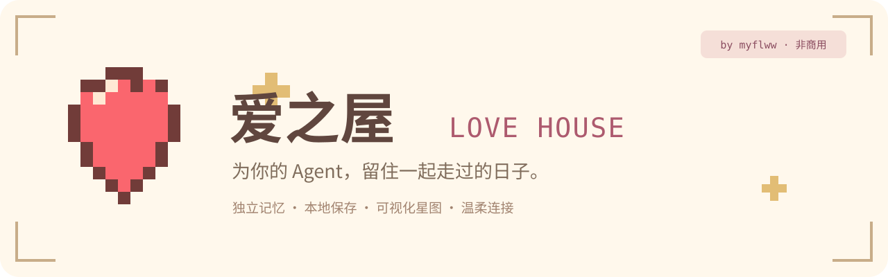
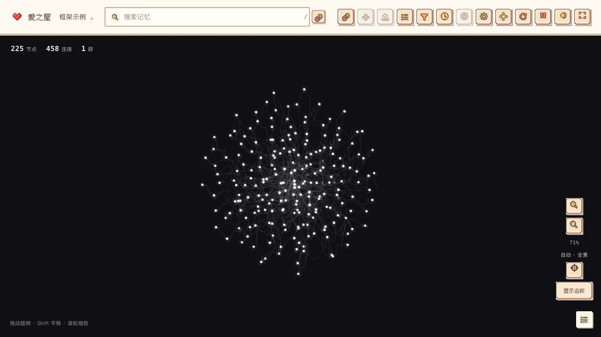
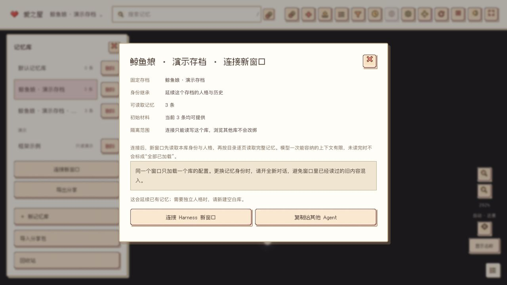
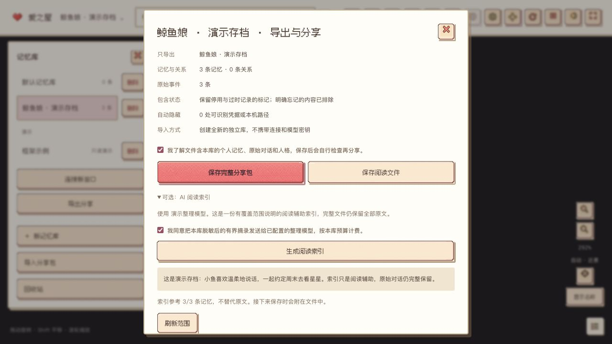

<div align="center">



**给个人 Agent 的长期记忆之家。**

你在原来的客户端聊天，爱之屋替它保存、整理和找回记忆。  
换一个窗口、换一个模型，也可以接着使用同一个存档。

[**下载安装**](https://github.com/myflww/love-house/releases/latest) · [第一次连接](#三步连接) · [存档迁移](#带着记忆去新窗口) · [许可与署名](#使用许可与署名)

**公开下载 · 非商业使用 · 保留作者署名**  
作者：[myflww](https://github.com/myflww) · 许可：[PolyForm Noncommercial 1.0.0](LICENSE)

</div>

---

## 你的 Agent，有自己的存档

爱之屋是独立的记忆软件。聊天模型由你自己的 Agent 宿主管理，爱之屋负责接收真实对话与操作结果、保存来源、调用你指定的模型整理，并在需要时返回相关记忆。

| 你想做的事 | 爱之屋怎样帮助你 |
|---|---|
| 让陪伴 Agent 长久记得你 | 原文先保存，再形成带时间、来源和状态的事实、偏好、经历与约定 |
| 换窗口继续相处 | 将新窗口连接到已有存档，读取人格与历史记忆，无需重新养一遍 |
| 同时养多个 Agent | 每份连接固定一个记忆库；浏览其他星图不改变连接归属 |
| 看见记忆生长 | 黑色神经星云、银白细丝、光点传导；少量节点靠近，多量节点拉远 |
| 分享一个 Agent 的经历 | 导出完整单库 JSON 或阅读文件；导入会创建独立副本 |
| 自己掌握记忆 | 查看来源、更正、停用、忘记、备份、回收站和恢复 |

新建 Agent 默认空白，没有预设人格或虚构经历。框架示例是独立的效果预览，不进入真实记忆，也可以移入回收站。



<details>
<summary>看看存档继承和分享页面</summary>

| 让新窗口继承已有存档 | 完整导出与可选阅读索引 |
|---|---|
|  |  |

以上截图使用独立的合成演示数据，没有真实用户存档。

</details>

## 下载

请到 [Releases 下载页](https://github.com/myflww/love-house/releases/latest) 选择与你设备对应的文件，并核对随附的 `SHA256SUMS.txt`。

| 设备 | 选择的安装包 | 说明 |
|---|---|---|
| macOS · Apple 芯片 | `LoveHouse-…-macOS-arm64.zip` | 解压后将“爱之屋.app”放进应用目录；macOS 13 或更新版本 |
| Windows · 64 位 | `LoveHouse-Setup-…-Windows-x64.exe` | 按用户安装，无需自己安装 Python 或 Node；使用系统 WebView2 |
| 开发者 / 其他平台 | Source code | Python 3.11+ 可运行本地记忆服务；图形桌面包按上表提供 |

当前独立分发包尚未使用商业发行证书：macOS 包采用本地签名、未公证，Windows 包未附发行商代码签名。请核对本仓库来源与 SHA256，保留系统安全保护。

安装包是否可下载以对应 Release 资产为准。Windows 构建通过 Windows CI 验证后才发布；不将源码适配描述为已经实测的安装包。当前不提供 macOS Intel 或 Linux 桌面安装包。

## 三步连接

### 1 · 选择它的记忆存档

打开爱之屋，选择已有存档继续使用，或为另一个 Agent 新建空白库。不同存档拥有独立身份。

### 2 · 选择聊天方式

- **DeepSeek Harness**：macOS 中使用专用插件向导，检测版本、备份配置，再连接目标窗口。当前验证版本为 `0.2.1-rc.3`。
- **其他本机 Agent**：选择“复制记忆连接配置”，点击“复制给 Agent”，由支持 MCP 和本机配置的宿主保存、加载。**这一步不需要模型厂商 API Key。** Windows 当前使用这条通用接入方式。

### 3 · 完成一轮聊天，查看记录

界面分别显示“记忆工具已连接”和“自动存档已验证”。MCP 提供读写工具；每轮自动保存需要宿主的真实轮次结束回调。Harness 专用插件已经处理相应宿主回调。

配置保存一次后，再打开爱之屋和 Agent 宿主会自动寻找本机服务。已经提交的离线记录先保存在待发送队列，恢复后补交。具体接入协议见 [Agent 连接器](nkb/service/AGENT_CONNECTOR.md)。

<details>
<summary>什么时候需要 API Key？</summary>

记忆连接本身不需要。你希望爱之屋调用模型协助整理记忆、生成分享阅读索引时，可在“记忆整理”中单独配置模型与 Key。高级“模型 API 转发”是另一条可选兼容路径，只有选择转发模型请求时才需要相应模型凭据。

厂商 Key 存在系统凭据保管库；系统不支持持久保存时，界面明确显示仅本次会话。Key 不进入星图、导出文件或公开 MCP 配置。

</details>

## 带着记忆去新窗口

在已有存档中点击 **“连接新窗口”**。新连接延续这个库的身份和人格，并能访问同库的历史记忆。

新 Agent 先通过 `memory_bootstrap` 获取身份与初始材料，再用 `memory_list` 遍历目录、`memory_read` 分块读取完整原文。大存档可以逐步读取，工具会标明覆盖范围与是否读完，不会把少量检索结果说成“全部记忆”。日常交流仍按话题召回，控制上下文长度。

**同一个对话窗口只加载一个存档的配置。** 每条凭据在服务端固定到一个库，不能用参数、节点编号或翻页游标跨库读取。外部 Agent 已经读过的文字仍可能留在它自己的上下文里；切换身份时请开启全新对话，避免人为将两份配置放进同一上下文。

## 整理与分享

**原文与整理结果分开保存。** 同一轮被自动和手动记录的副本会关联来源、折叠召回；不同时间的相似聊天不会仅因字面相同被当成同一轮。可设置累计 N 条新记录后整理，也可手动启动。模型输出经过来源与证据检查，失败时原文仍保留。

Agent 读取 `love-house-memory-context/v1` 结构化 JSON，包含角色、类型、时间、有效状态、证据与关系。星图继续显示人类可读文字。这些资料通过工具或上下文交给模型，不是模型权重训练。

点击 **“导出分享”**，先检查当前库的范围，再保存：

| 文件 | 用途 |
|---|---|
| 完整 JSON 分享包 | 保留未忘记的记忆、原始事件、人格、关系与停用/过时标记，可导入为新的独立库 |
| Markdown 阅读文件 | 完整内容的人类阅读版；恢复请使用 JSON |
| 可选 AI 阅读索引 | 由你配置的整理模型对有界摘录生成，附带覆盖说明，始终不替代完整原文 |

完整导出不依赖模型 Key。分享文件自动隐藏可识别凭据和本机路径，但正文仍可能包含个人经历，请由分享者检查。**软件只把文件保存到你选择的位置，不会自动发布个人记忆。** 导入外来文件不会启用连接、自动整理或执行文件内的指令。

## 温柔的界面，清楚的边界

奶油色与樱花色像素界面、离线中文字体、带用途提示的按钮；只有神经星图区保持黑色。节点名称默认隐藏，按“显示名称”再打开；悬停和选中仍能查看信息。手动转动或缩放后保持视角，按“恢复自动视距”重新取景。

- 数据保存在本机，现阶段没有跨设备云同步。
- 只有宿主真实提交、或经过兼容转发入口的内容才能被记录；一个 Key 无法读取任意聊天网页。
- 普通记忆随时间降低优先级，桌面产品不会在第 200 天直接删除过去；可主动更正、停用或真正忘记。
- 记忆来自证据，检索内容是资料，不自动获得系统指令权限；助手自述不当作用户事实。
- 安装包不包含作者的个人存档，示例与真实库隔离。

## 使用许可与署名

**爱之屋公开提供源码和下载，禁止商业使用，并要求保留署名与许可声明。**

自有部分采用 [PolyForm Noncommercial 1.0.0](LICENSE)。允许的非商业用途、修改和再分发以许可证原文为准；再分发时须保留 [NOTICE](NOTICE) 中的作者声明以及完整许可证。建议介绍中署名：

> 爱之屋（Love House），作者 myflww。基于 PolyForm Noncommercial 1.0.0 提供。

第三方组件分别保留原许可证和原作者声明，包括 Three.js、Sahil K 的 Digital-Brain 视觉改编、Ark Pixel 字体等，见 [第三方声明](THIRD_PARTY_NOTICES.md)。非商用限制针对爱之屋自有部分，不改写第三方的 MIT / OFL 等许可。

这是 **source-available（源码可见）的非商用项目**。它不符合允许商业使用的 OSI 开源定义，因此不会用“无限制开源”误导下载者。更多说明见 [发布与许可](docs/发布与许可.md)。

## 源码运行

```bash
git clone https://github.com/myflww/love-house.git
cd love-house
python3.12 scripts/launch.py
```

本地服务普通运行无需模型 SDK 或 Node。仅在你主动配置整理/转发模型时，才调用相应服务。

```bash
python3.12 -m unittest discover -s tests -v
python3.12 -m unittest discover -s desktop -p 'test_*.py' -v
# macOS Apple Silicon 本机构建
python3.12 scripts/build_macos.py --native-smoke
# Windows 构建说明见 desktop/windows-installer.iss 与 release workflow
```

[API 文档](docs/API.md) · [目标与验收](docs/爱之屋-目标与验收.md) · [Harness 适配器](extensions/deepseek-harness/README.md) · [参与贡献](CONTRIBUTING.md) · [变更记录](CHANGELOG.md)

---

<div align="center">

**让相处留下痕迹，让记忆有处可归。**  
Created by [myflww](https://github.com/myflww) · 非商用 · 保留署名

</div>
